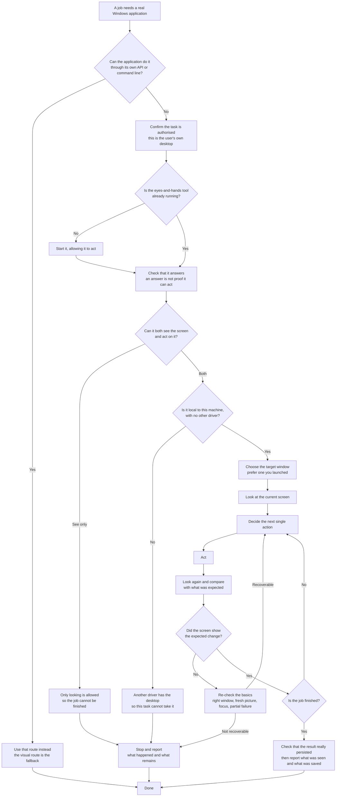

# Driving a Windows application: the executive view

What happens when an agent is asked to operate a real Windows application through BRYES. The
agent is the decider; BRYES supplies eyes and hands only. No step here depends on a command,
a coordinate or an endpoint, so a reader can follow the shape without the technical detail.
The full procedure is [drive-the-desktop.md](../procedures/drive-the-desktop.md).

## Two abilities, not one

Connecting is not a single switch. The tool has to be running, and it has to be allowed to act
as well as see. A healthy answer only proves it is talking. When only seeing is possible, the
job cannot be finished, and the gap is reported rather than worked around.

## The rules that hold at every step

- **One authorised task.** Act only inside the task that was agreed, and never touch unrelated
  work on the same desktop.
- **One driver at a time.** The desktop is shared with the person using it. Do not compete for
  the mouse or keyboard, and leave shared processes running.
- **Look before you act, and look again after.** Every picture is a moment; a window that moved,
  a layout that changed or a stale image makes the next action wrong.
- **"It answered" is not "it worked".** A completed call, a visible change and a saved result are
  three separate claims. Report each one for what it is.
- **A half-finished sequence is not rolled back.** When a sequence stops partway, look at the
  desktop before deciding what remains, and never replay it blindly.
- **Stop rather than improvise.** If the result cannot be confirmed, or the task would reach
  beyond what was authorised, stop and say so.

## A note on the alternative

There is a second entry point where the whole goal is handed to BRYES and it decides every step
itself. That is a different way in, not a different set of rules: the same authorisation,
targeting and verification apply.
