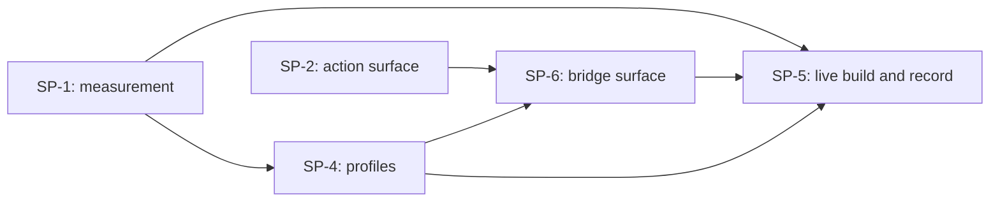

# Council of Wizards Plan

## **FEATURE INFO**
- **Project**: BRYES
- **Date**: 2026-10-28
- **Agent**: Claude Software Architect
- **Feature**: Let the agent do Unreal Blueprint work itself: measure grounding on real editor frames, build the vision path (Windows and Unreal profiles, a delta drag, a pointer the Brain can aim by absolute pixel), and drive the editor through its Python / Remote Control API, with BRYES verifying the result.
- **Source Protocol**: `/council-of-wizards` — /council-of-wizards

*CRITICAL INSTRUCTION: To continue this plan: load the source protocol above, then inspect which sections below are filled vs unfilled to infer your current step.*

---

## **INHERITED CONTEXT**
*Filled at investigation step 0 with whatever was settled before this plan existed. The two sources are recorded separately and never merged — write "None" under a part that does not apply.*
*These decisions are **not yours to reopen**. If one looks wrong, STOP and surface it to [USER-NAME] — do not silently re-decide it here or in Confirmed Decisions below.*

### From the Parent Plan
- **Parent plan**: None — not a sub-plan
- **Assigned scope**: None

| # | Inherited decision | Chosen | Parent's reason | Status |
|---|--------------------|--------|-----------------|--------|
| — | — | — | — | — |

- **Integration contracts**: None
- **Pushed-down open items**: None

### From Pre-Planning Discussion
- **Discussion**: Pre-planning discussion with Alvi, 2026-10-28 (in the awakening session, after the drag/grounding investigation)
- **Agreed scope**: Make the agent able to perform Unreal Blueprint edits itself, including dragging inside the graph. Three tracks, all wanted: measure the Eyes' grounding on real editor frames first; build the vision path properly; and use Unreal's own API. Plus two capability additions: a delta drag, and the ability to drive the mouse by absolute pixel position.

| # | Settled decision | Chosen | His reason | Status |
|---|------------------|--------|------------|--------|
| 1 | Measurement before building the vision path | Track A is in scope: score `locate()` against real Unreal frames | His answer was "1. A + B + C" to a round that recommended A first because it is the only option that cannot be wasted: it costs minutes and its number either green-lights the vision path or sends the work to the API | Settled |
| 2 | The vision path | Track B is in scope: Windows + Unreal profiles, delta drag, verify-by-focus | Same answer, "1. A + B + C"; he wants the agent to see and act on the editor, not only to call its API | Settled |
| 3 | Unreal's own channel | Track C is in scope: drive the editor through its Python / Remote Control API | Same answer, "1. A + B + C"; ADR-001 puts API before vision, and he wants both rather than choosing | Settled |
| 4 | The empty-drop-point problem | A delta drag: `destination` may be an offset from the located start point, instead of a second described target | His answer was "2. A"; a graph canvas is a coordinate space, so a delta is meaningful there, while a second description of empty space is a guess the loop cannot detect | Settled |
| 5 | Pointer control by pixel | The agent must be able to drive the mouse by absolute pixel position, not only by a described target | His words: "I want the agent to be able to drive the mouse by position in pixels" | Settled |
| 6 | Authority of the measurement | Diagnostic within the vision path, not a gate that can cancel it | He chose A and B together, so the number can shape the vision path (zoom, prefer right-click node creation, lean on the API) but cannot decide the vision path will not be built | Settled |
| 7 | Which Unreal project | `lsgi` | His answer to OQ1: "OQ1: lsgi" | Settled |
| 8 | Who owns the Unreal facts | BRYES stays a visual executor; which Unreal is installed and what its editor offers belongs to `agent-lsgi-unreal` | His words: "we also have agent-lsgi-unreal. I think that's up to the agent. it's a mechanism to detect what's installed, bryes should just do visual execution" | Settled |

- **Considered and rejected**: Vision only (B alone) and API only (C alone) → he chose all three tracks; named-anchor-only drops and Brain-supplied absolute coordinates for the drop point → he chose the delta drag; the fleet's `agent-unreal` as owner of the editor-side facts → he named `agent-lsgi-unreal`, which owns this project's editor.
- **Left open**: which blueprint in `lsgi` is the first target (proposed: the lesson-06 basic-attack blueprint, because its steps and before/after screenshots are already committed), and the concrete expectation string that proves a drop landed (the mechanism is a requirement, the words are set at execution).

---

## **REQUIREMENTS BREAKDOWN**
*Filled AFTER [USER-NAME] confirms the WAIT Options (Step 6). This table is the formal record of confirmed requirements that informs the scope gate and sub-plan decomposition.*

| # | Requirement | Description |
|---|-------------|-------------|
| R1 | Grounding measurement on real Unreal frames | Score the Eyes' `locate()` against the committed `lsgi` lesson screenshots for three probe kinds: a node header, a pin, and an empty canvas point. Produce a per-kind accuracy number, saved overlay images, and a written verdict that steers every later step. This is the only requirement that can change the shape of the others. |
| R2 | Windows and Unreal Editor visual profiles | `profiles/windows/profile.md` (base real-desktop conventions) and `profiles/windows/unreal-editor/profile.md` (how the editor looks: graph canvas versus Details panel, node header versus pin, Content Browser), each with its Visual and Operating halves, inheriting up the path exactly as android and linux do. Listed in `profiles/index.md` by SP-2, so a named window plus a goal is enough to reach them. Unreal mechanics stay with `agent-lsgi-unreal`; these profiles describe appearance. |
| R3 | Delta drag | Extend the drag action so the drop point can be an offset from the located start point instead of a second described target, so a drop onto empty graph canvas needs no ungroundable description. Opt-in per action, because a delta on a normal window means nothing. |
| R4 | Pointer aimed by absolute pixel | The Brain can aim the pointer at a coordinate (click, move and drag from a pixel) without describing a target for the Eyes to locate. Requires the action schema, the prompt's coordinate rule, the per-body action vocabulary, and the loop branch; the host body's inside-the-window guard still applies to every coordinate. |
| R5 | ~~Unreal API channel~~ **RETIRED 2026-10-28** | Retired with SP-3: the outside agent calls Unreal's own API directly when an API is the right channel. Routing that through BRYES adds a hop and no value. Superseded by R11. |
| R6 | Proof that a drop landed | A named expectation over a `visual_focus` region that can settle whether a drag changed the graph (for example "the node named Basic Attack sits left of the Print String node"), so a drop is never trusted because nothing errored. |
| R7 | Live end-to-end build in `lsgi` | An outside agent builds the small real blueprint end to end (4 nodes created, 3 pinned connections wired, compile clean), using BRYES for the visual steps and Unreal's own API for the steps vision cannot do, with a screenshot proving the final graph. |
| R8 | Record and documentation | Update `docs/procedures/drive-the-desktop.md` (its "what this body cannot do" section is no longer wholly true), the orientation map entries the work touches, and the session record in `.agents/session/`, so the next session inherits measurement rather than folklore. |
| R9 | Host-body reachability | A named window selects the host body, so a caller does not have to name the device, and a host run that names no window is refused before the first action, because both host guards are no-ops without a target. The catalog entry that lists the body is R2's, and ships after this. |
| R10 | Host frame scope | The host body screenshots the monitor that holds the target window rather than the whole virtual desktop, so the editor keeps its resolution through the model's rescale. The monitor is resolved by `MonitorFromWindow`, not inferred from a title or a guess. |
| R11 | Bridge surface | A primitive-level surface (HTTP or MCP) that lets an outside agent compose visual actions without BRYES's Brain: screenshot, act at a coordinate (click, drag, key chord, type), locate by description, focus a window, and read the profile text both sides share. Each call returns pixels or coordinates. No goal, no loop, no decision. |

---

## **SCOPE GATE**
*Evaluate whether this feature truly needs multi-plan orchestration (council) or can be handled by a single `/high-wizard`.*

**Criteria** — council is needed when ANY of these are true:
- [x] The work holds **several deliverables, released together**, rather than one
- [x] It requires **integration contracts** between parts (one plan produces what another consumes)
- [x] The scope is **too large for a single `/high-wizard`** to cover without losing detail

**Not needed when**: the work is one deliverable whose release finishes it (a single `/high-wizard`), or its parts must pass phases that gate each other (that is `/rite-of-creation`).

**Assessment**: All three criteria hold. It is several deliverables, not one: a measurement rig, application profiles, two action-capability changes, an API channel, and a live end-to-end build, each of which can close and be handed over on its own. There are real integration contracts between them: R1's per-kind accuracy is consumed by whoever decides each step of R7, R2's profile paths are consumed by the loop, and R3 and R4 both change the same action contract that R7 exercises. And the scope is too large for one plan without losing detail: the two capability changes alone touch the Brain's schema, the loop, the device protocol, and every body, while the API channel is a new channel with its own preconditions. Note that the parts are sequenced rather than parallel in the main, because R1's number shapes how much of the vision path is worth doing, so this council is a dependency graph with little concurrency rather than a parallel batch.

**Decision**: [x] Proceed with Council | [ ] De-escalate to `/high-wizard`

*If de-escalating: delete this file, launch `/high-wizard` with the requirements already gathered above.*

---

## **CONFIRMED DECISIONS**
*These decisions were collected during decomposition investigation and confirmed by [USER-NAME]. The reasons serve as the analysis record for why the feature was decomposed this way.*

| # | Decision | Chosen | Reason |
|---|----------|--------|--------|
| 1 | How the host body becomes reachable | Listed: `profiles/index.md` gains a `windows` section, and the host body refuses to start a run that names no window; `window` selects the body and the catalog supplies the app profile underneath it; `BRYES_ALLOW_HOST` still gates the body | Revised from "keep it out" on Alvi's call ("yeah I'm thinking B"). The catalog should carry the app knowledge, so a caller does not have to remember a profile path. The window is what decides the desktop is in play, and making it mandatory closes a path that is unguarded today: `_ensure_foreground` and `_require_inside_target` both return early when no target is named, so a `windows` run with no window clicks the whole desktop unchecked. The catalog entry and its guard ship in that order: SP-2 adds the refusal, SP-4 adds the section together with the files it names, and the chosen execution order runs SP-4 after SP-2 |
| 2 | What the delivered capability must be | The agent builds a small real `lsgi` blueprint end to end (4 nodes, 3 wires, compile clean), with the channel per step chosen by the measurement, proved by a screenshot | "I want the agent to do it themselves" is answered by a blueprint that exists. With this shape a bad grounding number steers the channel instead of cancelling the vision path, so the measurement stays a diagnostic rather than a veto |
| 3 | Where the Unreal API channel sits | A capability on the same body, gated the way `shell` is (`caps.has_shell`), so one run keeps one body and the Brain chooses pixels or an API call per step | Chosen as recommended: the alternative made the per-step choice R7 promises impossible, and routing it through `shell` would put a Tier-1 channel behind a process boundary and a JSON encoding |
| 4 | Execution strategy | SP-1 first, then SP-2 and SP-3 in parallel sessions, then SP-4, then SP-5 | Chosen as recommended: the measurement is the cheapest piece and the one input SP-4 cannot do without, while the two heavy builds have no reason to wait for each other |
| 5 | Where the profile knowledge comes from | Basic Windows and Unreal Editor knowledge, the way the android, linux, whatsapp and chrome profiles were written; never derived from the `lsgi` lessons | His words: "lessons are for me, not for agents, the knowledge should be populated from basic windows + unreal knowledge (like the previous android / linux / whatsapp / chrome)" |
| 6 | What the host body screenshots | The monitor that holds the target window, resolved by `MonitorFromWindow` | His words: "the WindowsDevice.screenshot() should only screenshot that only monitor tho". Measured twice in this session and the layout moved between readings: first 3440x1440 at (0,0) with 1920x1080 above at y=-1080, later 1920x1080 at (0,0) with 3440x1440 at (-783,1080). Either way a whole-desktop frame spans both screens, and the rect must be read at capture time rather than cached |
| 7 | Where Unreal puts a new window | Unreal opens child windows on the primary monitor, so the editor must already be on that monitor before a run, or the profile's Operating half says to move it there first | His words: "unreal always want to show new window inside main monitor. so just in case the editor is opening not in main monitor, it needs to be moved first, or the new window (opening blueprint, project settings, etc) will show in the main monitor." Our own two captures show it: frame 01 caught the main editor on the secondary screen with Project Settings open there, and frame 02 caught the blueprint he opened on the primary |
| 8 | The Unreal API channel | Dropped. R5 is not being delivered, so SP-3 is closed with no work done | His words at wrap-up: "SP-3 is dropped". Consequence for SP-5: wiring now has no exact channel. Vision measured 1/5 on pins, so R7's three connections must be made either by eye with the graph zoomed and verified, or by hand with the agent doing the rest |
| 9 | What BRYES is in this feature | Hands and eyes for an outside agent, not a decision-maker: BRYES exposes visual primitives and shared vocabulary, and the outside agent composes them. The profiles are the vocabulary both sides use, inside for reading the screen and outside for naming what to click | His words: "making sure BRYES can act as a bridge from agent outside BRYES to do visual thing", and the correction that followed: "both inside and outside agent need to have those vocabulary so they can communicate well, especially the locate by description". This is why the surface is primitives rather than another channel BRYES decides on |

---

## **SUB-PLANS TABLE**
*Single canonical table — all other sections reference sub-plans by their ID. Do NOT duplicate this table elsewhere.*

| ID | Sub-Plan Name | Description | Requirements | Protocol | Plan File |
|----|--------------|-------------|--------------|----------|-----------|
| SP-1 | Grounding measurement rig | Score the Eyes' `locate()` on the committed `lsgi` lesson frames for three probe kinds (node header, pin, empty canvas point), hand-label the ground truth, and emit the report the other sub-plans read | R1 | HW | `SP-1-grounding-measurement.md` |
| SP-2 | Action surface and host reachability | Delta drag, a pointer the Brain can aim by absolute pixel, a way to prove a drop landed, the loop change that lets a profile travel with a pinned window, host-body selection (a named window selects the body, and a host run with no window is refused), and the host frame scoped to the target's monitor | R3, R4, R6, R9, R10 | HW | `SP-2-action-surface.md` |
| SP-3 | ~~Unreal API channel~~ | RETIRED 2026-10-28 with R5: the outside agent calls Unreal's own API directly | — | — | — |
| SP-4 | Windows and Unreal profiles | `profiles/windows/profile.md`, `profiles/windows/unreal-editor/profile.md`, and the `windows` section in `profiles/index.md` that lists them, authored from basic Windows and Unreal Editor knowledge the way the android and linux profiles were written, deliberately not derived from the `lsgi` lessons | R2 | QW | `SP-4-profiles.md` |
| SP-5 | Live `lsgi` build and record | An outside agent drives one real blueprint build through the bridge, with pins going through Unreal's own API, proven by screenshot, then the procedures, the map and the session record brought up to date | R7, R8 | HW | `SP-5-live-build-and-record.md` |
| SP-6 | The bridge surface | The primitive-level API an outside agent drives: screenshot, coordinate action, locate, focus, and the profile text both sides share. No Brain, no goal, no decision | R11 | HW | `SP-6-bridge-surface.md` |

**How to fill**: Each sub-plan groups related requirements into a coherent deliverable. Protocol column indicates `/high-wizard` (complex), `/pixel-wizard` (design-driven, with a visual reference to match), or `/quick-wizard` (simple). `Plan File` links to the sub-plan's file inside this folder once created. A `/quick-wizard` sub-plan keeps its plan in plan mode or in conversation rather than on disk, so its finished plan is written to that path once approved.

**Status lives in the Execution Log and nowhere else.** A status column here would be a second owner for one value, and it would go stale, because the procedure only ever advances a sub-plan in the log.

**Each sub-plan launch carries a handoff payload** — the decisions, contracts, and scope that bind it. See the Subplan Handoff component; a path alone is not a handoff.

---

## **INTEGRATION CONTRACTS**
*References to separate YAML contract files that define the interfaces between sub-plans. Use industry-standard formats (OpenAPI, AsyncAPI, JSON Schema).*

| Contract ID | Between | Format | File Path | Verified |
|------------|---------|--------|-----------|----------|
| C-1 | SP-1 → SP-4, SP-5 | JSON Schema | `contracts/measurement-report.schema.json` | [ ] |
| C-2 | SP-2, SP-3 → SP-5 | JSON Schema | `contracts/action-contract.schema.json` | [ ] |
| C-3 | SP-2 → SP-4, SP-5 | JSON Schema | `contracts/run-invocation.schema.json` | [ ] |

**How to fill**: Identify what data/interfaces flow between sub-plans. Create a YAML contract file for each integration point using the appropriate industry standard. File paths are relative to this plan's folder. The "Verified" column is checked during Feature Completion when both sides of the contract are confirmed working.

*If no integration contracts are needed (sub-plans are independent), write "None — sub-plans have no integration dependencies" and remove the table.*

---

## **DEPENDENCY GRAPH**
*Mermaid diagram showing sub-plan relationships. Identifies what can run in parallel and what must be sequential.*

**Parallel opportunities**: SP-2 and SP-4 have no dependency on each other, so the profiles can be written while the action surface is being built. SP-6 needs both.

**Critical path**: SP-2 (already in progress) then SP-6, then SP-5. SP-4 runs alongside and only has to land before SP-6 serves the profile text.

**How to fill**: Draw dependencies based on which sub-plans produce outputs that others consume (linked to Integration Contracts). Sub-plans with no dependency between them can run in parallel — highlight these opportunities. The critical path is the longest chain of sequential dependencies.

---

## **EXECUTION LOG**
*Track progress of each sub-plan. This is the single source of truth for master-level progress **and for every sub-plan's status** — the Sub-Plans Table deliberately carries no status column. Each sub-plan's own plan file has its own detailed execution log.*

**Execution Protocol for AI**:
I have to use this document as my **ONLY** source of truth to track which sub-plans are done and which are next. For each sub-plan, I launch `/high-wizard`, `/pixel-wizard` or `/quick-wizard` as specified in the Sub-Plans Table, then update this log. Sub-plans can be executed in parallel if the dependency graph allows.

| Sub-Plan | Status | Started | Completed | Agent/Session | Notes |
|----------|--------|---------|-----------|---------------|-------|
| SP-1 | DONE | 2026-10-28 | 2026-10-28 | software-architect | Harness plus two frames. Corrected, reproducible: headers 2/3, pins 1/5 (median 10.6 px), asset tiles 6/6, empty canvas 0/6. One screen measured |
| SP-2 | DONE | 2026-10-28 | 2026-10-28 | software-architect | Host frame (monitor), window-selects-body and the no-window refusal, delta drag, coordinate verbs, post-drag diff. Quality review fixed 5 findings. **Runtime verification NOT done** — no live host run yet |
| SP-3 | DROPPED | — | 2026-10-28 | — | Alvi dropped the Unreal API channel at wrap-up. No work had started; R5 is no longer being delivered |
| SP-4 | IN PROGRESS | 2026-10-28 | — | software-architect | Both profile files written, loading and committed; the catalog section lands now that SP-2's R9 refusal has shipped |
| SP-5 | NOT STARTED | — | — | — | — |
| SP-6 | IN PROGRESS | 2026-10-28 | — | software-architect | Planning at high-wizard Phase 1: technical-core round |

**Status values**: NOT STARTED → IN PROGRESS → DONE → BLOCKED (with reason in Notes)

---

## **QA HANDOFF**
*Filled at Step 18. This council is **not** runtime-verified — this section records the plan for that verification, which happens in a QA session with the stack up. Each sub-plan owns the checklist for its own change; this section owns the batch, which no sub-plan can see.*

- **Sub-plan checklists**: [`qa/checklists/{feature}.md` for each sub-plan that produced one, with the skip and its reason for each that did not]
- **Cross-plan integration**: [exercised — what ran it (an `/integration-test` run, or a named test) | NOT covered — why]
- **Runtime verification**: **NOT DONE.** Next action: [run each sub-plan's checklist with the stack up — `/run-qa-test --checklist <path>` per checklist]
- **Release**: [the sub-plans this batch releases together — one deployment for the batch, not one per sub-plan]

---

## **FEATURE COMPLETION CHECKLIST**
*Final verification before marking the feature complete.*

- [ ] All sub-plans have status DONE in Execution Log
- [ ] All integration contracts verified (Verified column checked)
- [ ] Cross-plan integration settled, and the `## QA HANDOFF` section filled: the sub-plan checklists listed, and the batch marked **not runtime-verified** with its next action
- [ ] No BLOCKED sub-plans remaining
- [ ] Documentation updated (if applicable)
- [ ] The sub-plans that shipped together are released **once** — batch them into a single deployment rather than deploying per sub-plan
- [ ] [USER-NAME] confirms feature is complete

---

## **POST-COMPLETION**
After feature is complete and checklist passes, move the entire council folder to `plans/completed/`:
`mkdir -p ./plans/completed && mv ./plans/[this-folder] ./plans/completed/[this-folder]`
