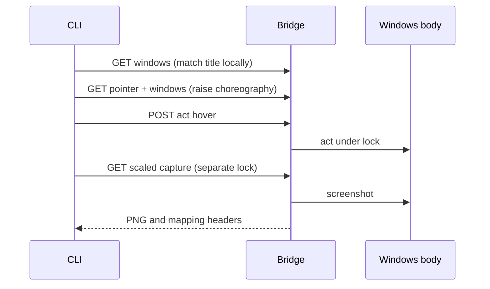
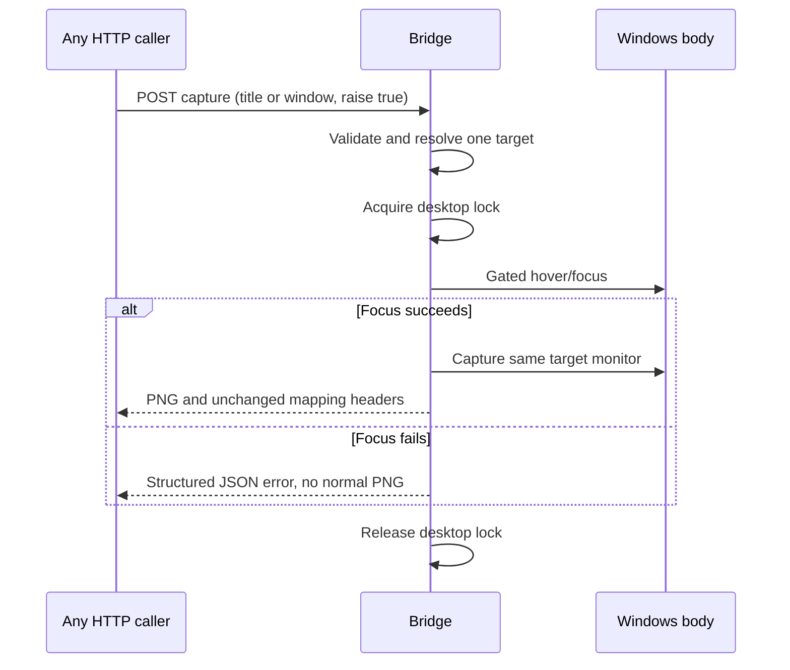

# High Wizard Plan: Windows Bridge Server Conveniences

## **PROJECT INFO**
- **Project**: BRYES
- **Date**: 2026-10-30
- **Planning agent**: software-architect, GPT-6.1 Sol
- **Implementing agent**: GPT-6.1 Terra, in a subsequent session (not launched by this plan)
- **Theme**: Move the agreed server-owned conveniences out of caller orchestration.
- **Source template**: Hermod's `high-wizard-plan-template`, downloaded verbatim from `https://hermod.lok.quest/content/high-wizard-plan-template`, then filled.
- **Workflow**: Explicit planning-only request. The High Wizard template is used; the full `/high-wizard` procedure was not run. Read this whole file before implementation, preserve inherited decisions, execute and log each step below. Do not restart a planning questionnaire for settled scope.
- **Status**: Implemented with model-free verification. Live Bridge desktop verification remains unperformed.

---

## **INHERITED CONTEXT**

### From the Parent Plan
- **Parent plan**: None, not a sub-plan.
- **Assigned scope / integration contracts / pushed-down items**: None.

### From Pre-Planning Discussion
- **Discussion**: Alvi and software-architect, 2026-10-30, this OpenCode session.
- **Agreed scope**: Move every convenience classified **Server** in the discussion table into the server. Defer rows classified Client, Both, or Depends. Leave a precise implementation handoff for Terra rather than implementing now.

| # | Settled decision | Chosen | His reason | Status |
|---|---|---|---|---|
| 1 | Ownership | Server-side title resolution, bringing the window forward, clear HTTP errors, ordered batch execution | "for Best home = server, let's move it all to server. we will do the follow up later for the other." | Settled |
| 2 | Batch execution | Existing `/act` accepts `actions`; stop at the first failure | "stop at the first failed action" | Settled, already implemented before this plan |
| 3 | Handoff | Plan only, implementation by Terra later | "I want you to create the plan using plan template in hermod's resource. I will use 6.1 Terra agent to implement that" | Settled |

- **Considered and rejected**: A separate `/multiple-act` was not selected; `/act` already handles both single and batch requests. Do not replace it.
- **Deferred**: Server coordinate mapping, capture IDs/retained mapping, file saving, JSON request construction, CLI error printing/exit codes, configurable settle delays and between-action waits. No client removal, no new UI, no model/provider change.
- **Implementation choices**: The exact additive wire fields and error statuses below are the architect's proposed implementation defaults, not choices claimed to have been explicitly made by Alvi. Surface a genuine conflict with the existing system instead of silently changing the contract.

---

## **OBJECTIVES**

An arbitrary HTTP caller should be able to select a unique target by title, request a focused capture in one request, and receive consistent structured errors without reproducing the Python client's orchestration. The optional CLI stays useful for files and coordinate mapping, but is no longer the owner of targeting/focus rules.

### **Related Documents**
- [Server and endpoint contract](../../api/README-Bridge.md)
- [Optional CLI client](../../api/README-Bridge-Client.md)
- [Server implementation](../../api/bridge-windows.py)
- [Client implementation](../../api/bridge_client.py)
- [Windows body](../../devices/windows.py)
- [Bridge tests](../../api/test_bridge.py) and [client tests](../../api/test_bridge_client.py)
- [Desktop-driving procedure](../../docs/procedures/drive-the-desktop.md)
- [Host safety decision](../../docs/adr/2026-10-21-host-body-and-gates.md)
- [Quality standard](../../docs/quality-standard.md)
- [Latest localized session](../../.agents/session/bryes-visual-bridge.md)

### **SUCCESS CRITERIA**
- [ ] Every target-taking route accepts a unique title or an explicit handle, consistently.
- [ ] Zero/ambiguous title matches cause no desktop input or screenshot/model call; no implicit first/largest match.
- [ ] An explicit focus-and-capture request resolves once, focuses and captures under one lock, and retains PNG/header contracts.
- [ ] Existing GET captures stay read-only and ungated; focusing/input still require `BRYES_ALLOW_HOST=1`.
- [ ] All Bridge failures return JSON with `error` and `description` and appropriate non-2xx status; batch progress survives failures.
- [ ] Existing single/batch `/act`, pointer-without-target, CLI commands, image mapping, and optional profiles behavior remain compatible.
- [ ] Model-free contract and body/client regression suites pass; docs, procedure and orientation references reflect the new contract.
- [ ] Static review and runtime QA status are recorded honestly; no fabricated live-desktop proof.

---

## **SCOPE**

### In Scope
- Shared request-level target resolver, using the injected live window lister.
- Server-owned optional focus before capture, without state-changing GET requests.
- Shared safe HTTP error handling and tests across all Bridge routes.
- Regression coverage for the batch feature already present, not a rewrite of it.
- Thin client integration so `--title` and capture `--raise` delegate to server rules.
- Focused documentation and model-free verification.

### Out of Scope
- Coordinate conversion on the server, stored captures/mappings and file lifecycle.
- Batch CLI syntax, wait actions, UI readiness detection, configurable settle, retries or rollback.
- Host isolation/authentication/network redesign, Task API changes, moving window enumeration between modules merely for tidiness.
- Automatically acting on Unreal or an existing user window, saving user assets, global procedure installation, commits/pushes, and starting a Terra agent.
- Unrelated lesson directories or other concurrent work.

---

## **CONFIRMED DECISIONS**

Written-through architect defaults for this handoff; inherited user choices are recorded above.

| # | Decision | Chosen | Reason |
|---|---|---|---|
| 1 | Target syntax | Exactly one of `window` or `title`; both refused, no precedence | Prevent an unnoticed second selector from redirecting input. The existing client already refuses ambiguous titles. |
| 2 | Title semantics | Trim nonempty string; case-insensitive substring; exactly one visible target | Match the CLI's current intent without the body's unsafe largest-match fallback. Resolve into a concrete handle once per request/batch. |
| 3 | Focused screenshot transport | Add POST variants of the three existing capture routes, JSON body, optional `raise: true`; GET forms unchanged | Focus changes the desktop, so it must retain the JSON write guard rather than becoming a focus-changing GET. No extra capture service or session state. |
| 4 | Focus mechanism | Move the existing safe-hover focus sequence into a server helper, using `device.act(hover)` | Reuses host gate, foreground/owned-menu behavior and pointer bounds. No new private-method dependency or alternative unsafe Win32 focus implementation. |
| 5 | Compatibility | Additive targeting/capture features; retain successful response shapes | Existing clients still work against the new server. Updated CLI requires the new server; do not silently fall back on old behavior. |
| 6 | Error contract | Keep `error` and `description`; centralize unexpected failures; preserve batch progress | Errors already exist on server. Complete and verify the existing ownership rather than invent a client-shaped presentation layer. |

---

## **SOLUTION**

### Architecture Overview

HTTP request -> validate shape and selector -> resolve live target once -> existing WindowsDevice -> JSON or PNG. Window resolution is shared across routes. The global Bridge lock continues to serialize desktop operations; focus and capture use one acquisition. The client constructs requests and handles local files, not target matching or focus policy.

### Component 1: Target resolution
- **Key file**: [api/bridge-windows.py](../../api/bridge-windows.py), within/alongside `make_app` so the existing injected lister is used.
- **Routes**: `/screenshot`, `/downscaleshot`, `/upscaleshot`, `/act`, `/locate`, and optional targeting for `/pointer`. `/health`, `/windows`, `/profiles` are not target-selecting operations.
- GET selectors come from query fields; POST selectors come from JSON. `/act` selectors belong only at request level, never inside batch actions. Reject per-action `title` as well as `window`.
- `window`: retain hexadecimal ID syntax; require a positive handle corresponding to a target in the current lister. Never pass a malformed/stale ID into monitor fallback. Match IDs numerically, not by differently formatted hex strings.
- `title`: a nonempty, stripped string, case-insensitive substring of enumerated titles. Zero matches -> 404. Multiple matches -> 409, with candidate `id` and `title` entries in an additive `matches` array. Invalid selector, both provided, or missing required selector -> 400. Present-but-empty/null is invalid, not absent.
- `/pointer` with neither selector remains global; specifying an invalid selector must not silently become global. `/pointer?title=...` returns the same target-relative fields as its handle form.
- All successful paths pass the resolved handle, not a title, to the device factory. Enumerate once for selection; reuse the selected entry for focus geometry and pointer window bounds. An explicit ID can also select that entry. Do not repeatedly resolve a title inside a batch.
- Resolution cannot eliminate window closure/reuse races after enumeration. Body checks still apply; never automatically reselect another match or retry an action. Record this limit.

Examples (illustrative title, not a live target instruction):
```http
GET /downscaleshot?title=Unreal%20Editor&scale=0.5
GET /pointer?title=Unreal%20Editor
```
```json
{"title":"Unreal Editor","actions":[{"type":"click","x":200,"y":100},{"type":"type","text":"abc"}]}
```

### Component 2: Server-owned focus and capture
- **Key file**: [api/bridge-windows.py](../../api/bridge-windows.py). Avoid changing the Windows body unless a concrete correctness issue requires it.
- Add POST `/screenshot`, `/downscaleshot`, `/upscaleshot`. Body fields mirror GET query fields, plus optional boolean `raise` (default false). POST requires `application/json` and a JSON object. Do not coerce strings such as `"false"` into true.
- Preserve GET parameters and defaults, including scale ranges, crop bounds, PNG bytes, and existing `X-Bryes-*` headers. Reject a GET `raise` parameter with 400 and direct the caller to POST; do not silently pretend focus happened.
- The POST capture caller supplies `window` or `title`; examples:
```json
{"title":"Unreal Editor","raise":true,"scale":0.5}
```
```json
{"window":"0x1a","raise":true,"x1":100,"y1":200,"x2":300,"y2":400,"scale":2}
```
- Validate selectors, field types and scale/crop ordering before input. Full crop/frame bounds must also be checked before focusing: when `raise` is requested, use the injected frame provider for bounds (or a read-only frame if necessary), then validate again against actual captured image dimensions after focus. An invalid crop must not move the pointer merely to discover its invalidity. Do not duplicate slightly different validation rules between GET and POST.
- Inside the same `_LOCK` acquisition: obtain device pointer and selected target geometry; if pointer is inside its rectangle, hover at its current frame-relative coordinates; otherwise hover at target center in frame coordinates. Convert using the selected monitor origin from `frame_provider`. This is the client's current `raise_point` behavior, not a click.
- Send that hover through `device.act`, preserving the gate, rect checks and foreground-owner logic. Keep the current CLI's 0.3-second focus/repaint grace here for equivalent behavior, then capture before releasing the lock. This is a narrowly scoped migration of existing focus behavior, not configurable settle/wait support. Never sleep after ordinary captures or actions as part of this plan.
- A focus failure returns an error, not a normal PNG of the wrong application. Plain captures do not invoke `device.act`, move the pointer, or require host-input permission. Focus helpers must not reacquire the non-reentrant lock or call the server over HTTP.
- Human input and other applications remain outside this lock; focus does not prove screenshot privacy or UI readiness. Returned image is the target's monitor, not an isolated window crop.

### Component 3: Consistent failures
- **Key file**: [api/bridge-windows.py](../../api/bridge-windows.py).
- Preserve HTTPException handling and intentional statuses (400 invalid request, 404 absent target/profile/route, 409 ambiguity/device refusal, 415 wrong content type, 502 Eyes failure, 503 unavailable pointer).
- Add a shared unexpected-exception handler that logs the full exception server-side and returns 500 JSON with a stable generic `description`, not stack traces or sensitive exception details. Do not replace intentional 4xx/5xx HTTPExceptions with generic 500.
- Apply expected device RuntimeError/ValueError classification consistently to pointer/capture/focus/action paths. Model RuntimeError in `/locate` remains 502, not a device 409. Keep narrow exception boundaries so a model failure is not mislabeled as a target refusal.
- `/locate` must reject null/list/string/malformed JSON cleanly rather than calling `.get()` on arbitrary input. HTTP 404/405 and missing profile errors must stay JSON too.
- Preserve batch success and failure fields exactly: `actions` on success; `ok:false`, `error`, `description`, `completed`, `failed_index`, `failed_action` on execution failure. Unexpected batch errors use the same logging/safe-message policy but retain progress. Validation or selection failure occurs before any action; report 400/404/409 without invented completed actions.
- Do not auto-retry failed input. A failed action may have partially executed; prior inputs are not rolled back. An HTTP error is not a guarantee that nothing changed.

### Component 4: Thin optional client
- **Key files**: [api/bridge_client.py](../../api/bridge_client.py), [api/test_bridge_client.py](../../api/test_bridge_client.py).
- With `--title`, send the title selector directly to the target endpoint rather than doing client-side `windows()` + `pick_window()`. Explicit `--window` / `BRIDGE_WINDOW` remain supported. Preserve existing CLI selector precedence rather than unexpectedly changing environment behavior in this scope; send only the one chosen selector and document it accurately.
- For `shot/crop --raise`, send the new POST capture request with `raise:true`; remove the client's old window-list/pointer/hover choreography and its 0.3-second focus sleep. Plain capture may keep GET. Keep the Python `raise_window` helper only if actual callers need it; inspect references before removing any public helper. Do not invent a hidden no-op replacement.
- Keep image file saving, mapping sidecars, `--from` conversion, request serialization, CLI HTTP-error printing/exit code and `act --settle` unchanged. Do not add batch CLI commands.
- Preserve the CLI's default URL/output paths and single-action syntax. `windows` and `profiles` must still need no selector. A client helper may serialize title or window but must not own live matching rules.

### Cross-System Contract Impact (Blast-Radius Check)

**Classification**: new request fields / POST methods; previously lax invalid-target behavior becomes an explicit refusal. No successful legacy response fields are removed.

| Consumer | Coupling | Impact and proof |
|---|---|---|
| `api/bridge_client.py` | Builds query/JSON payloads and decodes PNG headers / JSON failures | Update only targeting/focus delegation; test exact outgoing requests and unchanged sidecars/conversion. |
| `api/test_bridge.py` | Injected window/device/locator fixtures | Fixtures must list any handle used; pin old success bodies and new negative controls. |
| `api/test_bridge_client.py` | Pure helpers and HTTP mocks | Replace expectations for local targeting choreography with server requests; keep local mapping and CLI errors covered. |
| `docs/procedures/drive-the-desktop.md` | Direct HTTP operator instructions | Document explicit handle as safest for an agent-started target; title is convenience, never permission to drive a random matching app. |
| `api/README-Bridge.md`, `api/README-Bridge-Client.md` | Public wire/CLI reference | Keep parameter explanations, returns, errors and examples accurate; show both GET read-only and POST focus behavior in endpoint table. |
| External callers, including globally installed procedure copies | Existing handle-based wire contract | Keep valid existing requests working. Installed docs remain older until deliberately refreshed; never claim they were installed. |

- **Deploy ordering**: new server first, then updated CLI; no automatic old-server fallback. Restart a previously running Bridge explicitly when actually testing runtime, not while merely editing.
- **Existing data**: saved PNG/JSON sidecars stay unchanged; no migration or retained server state.
- **Consumer registry**: none found in the inspected scope. Re-grep references before changing public helpers.

### System Flow Diagrams

**Current State:**


**End Result:**


### Technical Considerations
- Current route functions repeat ID parsing. `WindowsDevice(window=title)` selects the largest match, so using that fallback would violate unique-match semantics; inject only the resolved `hwnd`.
- `WindowsDevice.act` already gates real input and handles foreground/owned windows. `screenshot()` does not raise or gate input. Reuse those facts; do not call `_ensure_foreground` directly from the API.
- `_LOCK` is a non-reentrant `threading.Lock`. Internal helpers do the operation directly; route-to-route calls or nested lock acquisition would deadlock.
- Server now has batch code added in this planning session's predecessor work: full pre-validation, shared lock, progress reporting. It and README changes are uncommitted; preserve them. Do not start from an older HEAD and accidentally drop them.
- `git status --short` at investigation also showed untracked lesson folders `lessons/lsgi-03-simple-blueprint/`, `lessons/lsgi-04-class-vs-instance/`, `lessons/lsgi-05-state-tree-in-battle/`. They are outside scope and may be user/concurrent work. Recheck live status rather than treating this snapshot as current.
- Do not read or expose `.env`, and do not run live model calls for contract tests. No new dependency is needed.

---

## **IMPLEMENTATION PHASES**

### Phase 1: Target selection
- [ ] **Step 1.1: Baseline and shared resolver**
  - **Action**: Read current diff, tests, body safety behavior and this full plan. Run existing model-free Bridge/client tests. Implement the injected resolver with the contract above.
  - **Implementation**: One selector-validation/matching path; no global target state. Retain optional global pointer. Reuse selected entry and concrete handle per request.
  - **Testing**: Unique substring/case/whitespace match, explicit hex variants, nonexistent/stale handle, no title match, ambiguous matches and candidate metadata, both selectors, blank/null/non-string selectors. Use fake dependencies that raise if input occurs on refusal.
  - **Success Criteria**: Invalid selection never reaches a device input/model call; unique selection resolves once, and no fallback target is chosen.

- [ ] **Step 1.2: Wire every target-taking route**
  - **Action**: Integrate resolver into pointer, all captures, locate, and single/batch act.
  - **Implementation**: Query for GET, validated object for POST; reject per-action selectors. Keep targetless pointer and targetless profiles/windows/health.
  - **Testing**: Parameterize title/handle across routes with injected dependencies. Count lister calls for a title batch; verify one handle and ordered inputs. Preserve all old successful response shapes and screenshot headers. Exercise disappeared target without retry/reselection.
  - **Success Criteria**: Server targeting is consistent across the surface; existing valid handle requests and batches remain correct.

### Phase 2: Focused captures and errors
- [ ] **Step 2.1: POST capture variants and atomic focus**
  - **Action**: Add JSON POST forms and shared safe focus/capture helper.
  - **Implementation**: Parse boolean `raise` strictly, preserve GET purity, validate before input, focus via safe hover, move existing focus grace to server, capture under one lock. Keep mapping generation unchanged.
  - **Testing**: In-window pointer preserved; out-of-window pointer centers target; nonzero/negative monitor origins; gate/focus failure never produces PNG; plain GET and POST `raise:false` never act. Invalid scale/crop/raise/body/content-type produces no input. Assert event order and one lock acquisition; independently prove another concurrent Bridge input cannot run between hover and capture using threading Events, not timing guesses. Patch the grace sleeper in model-free tests.
  - **Success Criteria**: One HTTP call performs focus+capture; target, lock, gate and image mapping remain correct.

- [ ] **Step 2.2: Error consistency and batch preservation**
  - **Action**: Complete expected/unexpected failure handling across the app.
  - **Implementation**: Preserve HTTPException statuses, log unexpected exceptions and expose generic 500 messages; retain batch partial progress and stop-first semantics.
  - **Testing**: Inject pointer/capture/device exceptions, model RuntimeError, unexpected model exception, malformed `/locate` body, unknown route/method and missing profile. Assert JSON content type, non-2xx status, both error fields, no traceback/raw unexpected message. Batch first/middle/last and unexpected failure must report exact completed prefix and omit later execution. Verify lock releases after errors and next request works.
  - **Success Criteria**: Errors are machine-readable without converting intentional errors into 500 or losing progress.

### Phase 3: Client, docs and handoff
- [ ] **Step 3.1: Delegate existing CLI conveniences**
  - **Action**: Make `--title` and screenshot `--raise` use the server contract, leaving caller-owned features alone.
  - **Implementation**: Inspect helper references, simplify obsolete choreography, preserve selector precedence/defaults/local mapping/output/error reporting/settle. Update HTTP mocks, not only pure helper tests.
  - **Testing**: Mock requests and assert no `/windows` or `/pointer` preflight for title/focused capture; assert POST body includes title or ID and correct raise flag. Preserve existing type/key/drag/scroll/hold commands and mapping math. Error body remains printed and exit status remains failure.
  - **Success Criteria**: CLI uses server ownership rather than independently duplicating it; other clients can perform the same operation directly.

- [ ] **Step 3.2: Documentation, review and verification handoff**
  - **Action**: Update server/client READMEs, desktop procedure and touched orientation entries. Run scoped checks and fill review/handoff below.
  - **Implementation**: Explain targeting ambiguity, read-only GET versus focus-changing POST, host gate, error statuses and lack of automatic retries. Keep keyboard `text`/`key` examples and batch contract. Record optional-client value honestly. Do not claim global install refresh or runtime proof.
  - **Testing**: Run `python api/test_bridge.py`, `python api/test_bridge_client.py`, `python devices/test_windows_drive.py`, `python devices/test_host_input.py`, and `python setup-scripts/test_setup.py` (installer fixture test, not actual installation). Run scoped ruff on changed Python files if available and `git diff --check`; distinguish pre-existing lint findings rather than broad cleanup. Check new doc links and wire examples against tests.
  - **Success Criteria**: All scoped regressions pass or genuine blockers are surfaced; public docs match tests; static review and runtime status are filled. Implementation completion must not be described as live desktop verification.

---

## **EXECUTION LOG**
**Execution Protocol for AI**:
I have to use this document as my **ONLY** source of truth to execute and track the plan steps iteratively. I should **NOT** use additional tools like ToDos because it lacks the context of what should I do. Everytime I want to implement a step I have to check the reference to the original step plan above. Everytime a step has been finished I need to go back to this document to log what was done.
*In other words*:
- I have to make this document as the source of truth for the implementation phase on what I have worked on and what I will be working
- The original plan must be fully in my context, therefore, I have to make sure I loaded the **Plan File** before executing any task and read carefully the reference to the original step
- I have to do the implementation by doing it in order per step THEN, I ALWAYS have to fill the step log rightly after

**Definition of Done (applies to ALL steps)**:
- ✅ **Code Quality**: Code compiles/runs without errors
- ✅ **Testing**: Tests written and passing
- ✅ **Logged**: Implementation and testing logged below
- 🚫 **Blocked**: Get input from [USER-NAME] before assuming

### Phase 1: Target selection
- [x] **Step 1.1**: [Baseline and shared resolver](#phase-1-target-selection)
  - **Implementation Log**: Read the plan, current diff, Bridge tests and Windows body; added a shared injected-list resolver with strict selectors and ambiguity metadata. Route integration follows in Step 1.2.
  - **Testing Log**: Baseline Bridge and client suites passed; Bridge suite passed again with resolver tests for invalid, missing, ambiguous and unique selectors.
  - **Success Criteria / Result**: Resolver refuses invalid selections before device access and returns a concrete handle and selected entry.
- [x] **Step 1.2**: [Wire every target-taking route](#phase-1-target-selection)
  - **Implementation Log**: Routed pointer, captures, actions and locate through the resolver; rejected batch item selectors and preserved targetless pointer.
  - **Testing Log**: Bridge suite passed with title and handle coverage across routes, one lister call per batch, stale-target refusal before device/model calls, and batch-selector rejection.
  - **Success Criteria / Result**: Existing handle-based regression tests pass; target resolution is shared.

### Phase 2: Focused captures and errors
- [x] **Step 2.1**: [POST capture variants and atomic focus](#phase-2-focused-captures-and-errors)
  - **Implementation Log**: Added JSON POST capture variants, strict focus flag, pre-focus crop validation, hover and capture inside one lock, and retained GET capture behavior.
  - **Testing Log**: Bridge suite passed with negative-origin coordinates, focus refusal, invalid-input no-action checks and a threaded event-controlled interleaving test.
  - **Success Criteria / Result**: Focus and capture are one serialized request; live Windows behavior remains unverified.
- [x] **Step 2.2**: [Error consistency and batch preservation](#phase-2-focused-captures-and-errors)
  - **Implementation Log**: Added generic logged unexpected-error handling, expected device refusals and safe batch exception descriptions while preserving batch progress.
  - **Testing Log**: Bridge suite passed, including malformed locate, route/method/profile errors, device and model failures, secret suppression, batch stop positions and subsequent successful request.
  - **Success Criteria / Result**: Tested failures return JSON with preserved statuses and batch progress.

### Phase 3: Client, docs and handoff
- [x] **Step 3.1**: [Delegate existing CLI conveniences](#phase-3-client-docs-and-handoff)
  - **Implementation Log**: Checked helper references, removed local title/focus choreography, and sent selectors and focus requests to the server while retaining mapping and action behavior.
  - **Testing Log**: Client suite passed with fake-client request assertions for title, focused shots/crops, locate, actions and environment selector precedence.
  - **Success Criteria / Result**: Client no longer resolves or focuses targets locally.
- [x] **Step 3.2**: [Documentation, review and verification handoff](#phase-3-client-docs-and-handoff)
  - **Implementation Log**: Updated both Bridge READMEs, desktop procedure and orientation notes; reviewed the changed surface against the quality standard and recorded runtime limits below.
  - **Testing Log**: Bridge, client, Windows drive, host input and installer fixture scripts passed. Documentation local links and `git diff --check` passed. Ruff was unavailable both on PATH and as a Python module.
  - **Success Criteria / Result**: Model-free contract and regressions passed; no live Bridge proof or global install was claimed.

---

## **QUALITY REVIEW**

- **Status**: Scoped static review performed by the implementing agent; ruff unavailable.
- **Scope**: Reconcile Execution Log with actual diff/status, including new files. Expected server/client implementations and tests, plus documentation; avoid unrelated lessons.
- **Quality Standard**: [docs/quality-standard.md](../../docs/quality-standard.md). Review error classifications, host gates, GET purity, complete target validation, lock lifetime, compatibility and ASCII console output.
- **Findings / Fixed**: Resolver rejects malformed and stale handles before device creation; focus uses the host-gated action path under the capture lock; GET rejects `raise`; unexpected failures are logged without returning their details. Tightened hex syntax and constructor error handling during review. No separate reviewer was launched.

---

## **QA HANDOFF**

- **Scope**: Target resolution, server focus/capture and failure reporting. Model-free HTTP integration and device/client regressions are mandatory in the phases above.
- **QA instrument**: No `qa/` bench or QA-named path was found in the checkout. No bench was created.
- **Integration coverage**: Flask test-client tests use injected device/lister/locator, client HTTP mocks and a threaded focus/capture lock control. These prove contracts, not Windows foreground behavior.
- **Checklist**: No formal runtime checklist was written or run; the authorized future live checks are listed below.
- **Runtime verification**: **NOT DONE.** Do not operate a user application merely to close this plan. With explicit live-test authorization, use an agent-started disposable window and verify title resolution, a focused POST capture, gate refusal, pointer behavior, and a harmless batch; close only what the tester started. No model call is needed.
- **Remaining boundary**: Loopback/JSON gates and title uniqueness are not isolation or authorization. Screenshots may include other applications. Document unverified live behavior separately from automated test results.

---

## **POST-COMPLETION**
After all phases are executed, logged, and both **Quality Review** + **QA Handoff** are filled, move this plan to `plans/completed/`:
`mkdir -p ./plans/completed && mv ./plans/2026-10-30-bridge-server-conveniences.md ./plans/completed/2026-10-30-bridge-server-conveniences.md`
